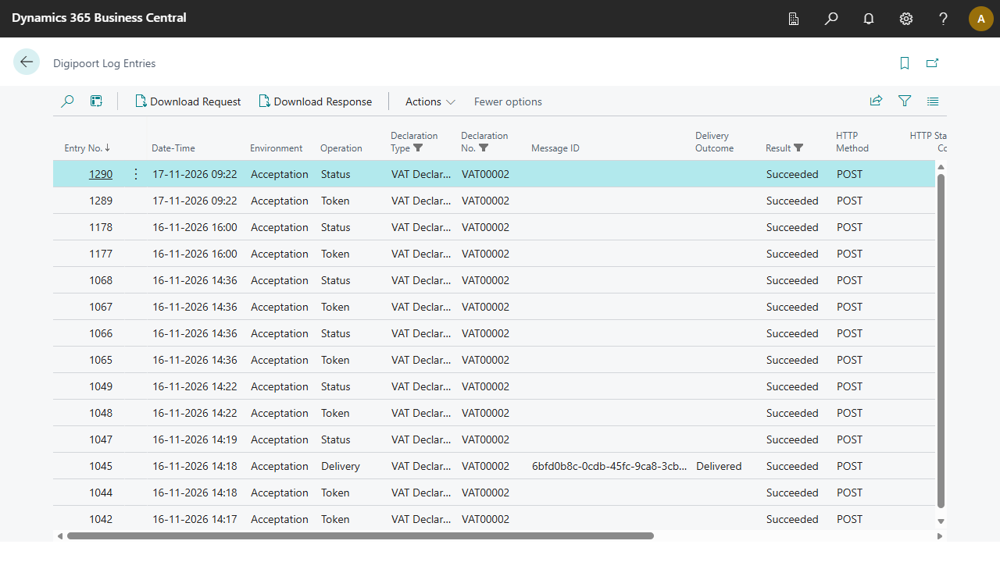

# Connection to Semansys and call log

## What this feature does

Digipoort Connector for Dutch VAT signs in to Semansys with Bluace's own Semansys login; you do not need a Semansys account. In this version you can test the connection: **Test Connection** signs in to Semansys and shows whether that works. It does not send a declaration or anything else.

Every call to Semansys is recorded on the **Digipoort Log Entries** page: when it was made, by whom, to which environment, and the result. Passwords, secrets and the sign-in token Semansys returns are not recorded.

Which Semansys environment is used follows the **Environment** field on **Digipoort Connector Setup**. In a sandbox environment, **Acceptation** is always used.

## Setup

You need the **Digipoort Connector** permission set, and the extension must be activated (see [Digipoort Connector Setup](digipoort-connector-setup.md)). Setting up a retention policy also needs the **RETENTION POL. ADMIN** permission set.

Bluace supplies the Semansys login details for **Acceptation** and **Production** with the extension; there is nothing to fill in. When a login detail cannot be read, **Test Connection** shows *The Semansys connection detail … for Production could not be read. Contact Bluace.*, with the environment and the name of the missing detail.

Also check:

- **Allow HttpClient Requests** must be on for Digipoort Connector for Dutch VAT. In a sandbox it is off by default, and after an environment copy it is off in every environment. To turn it on, see [After an environment or company copy](after-an-environment-or-company-copy.md).

**Clean up old log entries**

The log grows with every call to Semansys. You can delete old entries with a retention policy.

1. Search for **Retention Policies** and open it. Choose **New**.
2. In **Table Id**, choose **Digipoort Log Entry**. Under **Record Retention Policy**, a line that keeps entries with **Result** **Started** is added. It is locked and cannot be changed; see below for what such an entry means.
3. Under **Record Retention Policy**, add a new line and choose a **Retention Period**, for example one year. **Enabled** is turned on for that line automatically.
4. Turn on **Enabled** for the policy. If you close the page without doing so, you are asked *The retention policy is not enabled. Would you like to enable it now?*; choose **Yes**.

Good to know:
- **Apply to all records** cannot be turned on for this table, and **Retention Period** at the top of the policy cannot be filled in. The period is set on the line you add.
- No retention policy is created for you: without one, the log is never cleaned up.

## How to use

**Test the connection to Semansys**

1. Search for **Digipoort Connector Setup** and open it.
2. Choose **Test Connection**.
   - When the connection works, a message is shown: *The connection to Semansys (Acceptation) works.* In the messages below, *Acceptation* is the environment that is used; it can also be *Production*.
   - When it does not, an error is shown. The checks are done in this order:
     - The license is not valid or not activated: *Digipoort Connector for Dutch VAT license is not valid or not activated.*
     - A login detail is missing: *The Semansys connection detail … for Acceptation could not be read. Contact Bluace.*, with the name of the missing detail.
     - Business Central does not allow the extension to call Semansys: *Business Central blocked the request to Semansys. Turn on Allow HttpClient Requests for Digipoort Connector for Dutch VAT on the Extension Settings page.*
     - Semansys cannot be reached: *The connection to Semansys (Acceptation) failed:* followed by the reason.
     - Semansys refuses the sign-in: *Signing in to Semansys (Acceptation) failed with HTTP status …. See Digipoort Log Entries for details.*
     - Semansys answers without a sign-in token: *Semansys (Acceptation) returned a sign-in response without a token. See Digipoort Log Entries for details.*
3. Each attempt that reaches Semansys, or is blocked on the way, appears in **Digipoort Log Entries**, also when it failed. When the license or a login detail is the problem, nothing is logged.

**View the log of calls to Semansys**

1. Search for **Digipoort Log Entries** and open it. You can also choose **Log Entries** on **Digipoort Connector Setup**.
2. The newest call is shown first.

   

   For each call you see **Entry No.**, **Date-Time**, **Environment**, **Operation**, **Declaration Type**, **Declaration No.**, **Message ID**, **Delivery Outcome**, **Result**, **HTTP Method**, **HTTP Status Code**, **Request URL**, **Error Message** and **User ID**. **Declaration Type** and **Declaration No.** are blank for a call that was not made for a declaration, such as **Test Connection**.
3. To see what was exchanged, select a line and choose **Download Request** or **Download Response**. A text file is downloaded.
   - When nothing was stored, an error is shown: *Log entry … has no Request Body.* (or *Response Body*). For a sign-in (**Operation** **Token**), the request is never stored, because it contains the password.

Good to know:
- **Operation** shows what the call was for: **Token** (signing in), **Delivery** (submitting a declaration) or **Status** (getting the Digipoort status of a declaration). Submitting a declaration or getting its status adds a **Token** line when Business Central has to sign in first, then a **Delivery** or **Status** line. Both carry the declaration's number. When signing in fails, only the **Token** line is added.
- **Result** is **Succeeded**, **Failed** or **Started**. **Started** means the call was begun but its result was never recorded, for example because the session ended during the call.
- **HTTP Status Code** is 0 when Semansys did not answer, for example when the request was blocked or Semansys could not be reached.
- For a successful sign-in, **Download Response** contains only the token type, its validity in seconds and its scope, not the token itself.
- The log cannot be changed or deleted on the page. The only change you can make is **Mark as Not Delivered**; see [Submit VAT declarations via Digipoort](submit-vat-declarations-via-digipoort.md).
- When a declaration is submitted or its status is requested, Semansys also receives the company name from **Company Information**, the VAT number used for the declaration (the **Fiscal Entity No.** when **Part of Fiscal Entity** is turned on in **Elec. Tax Declaration Setup**), and Bluace's name and ID as the partner. Semansys uses them to identify who sent the message. A value that is empty is not sent. **Test Connection** only signs in and does not send them.
