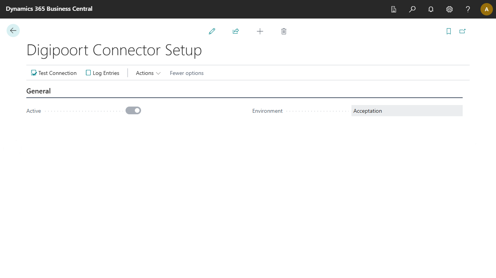

# Digipoort Connector Setup

## What this feature does

On the **Digipoort Connector Setup** page you choose the Digipoort environment for the company in the **Environment** field:

- **Acceptation**: the Digipoort test chain. Declarations are not filed officially.
- **Production**: declarations are filed officially with the Belastingdienst, and Digipoort charges every message offered to it.

Each company has its own setting. When the extension is installed, and when a new company is created later, the company gets **Production** in a production environment and **Acceptation** in a sandbox environment, with **Active** turned off. In a sandbox environment, **Production** cannot be selected. VAT declarations are submitted to the environment chosen here; see [Submit VAT declarations via Digipoort](submit-vat-declarations-via-digipoort.md).

With the **Active** field you switch VAT declarations in the company to Digipoort Connector: as long as **Active** is turned on, they are submitted and followed with the actions of this extension instead of the standard certificate route. A company starts with **Active** turned off, so opening the page alone changes nothing.

In Dutch, the page is called **Digipoort Connector-instellingen**, the fields **Actief** and **Omgeving**, and the values **Acceptatie** and **Productie**.

## Setup

You need the **Digipoort Connector** permission set, or SUPER. The extension must also be activated in Product Licensing; otherwise the **Digipoort Connector Setup** page does not open.

**Activate the extension (Business Central online)**

1. Search for **Bluace Products** and open it.
2. Select the line **Digipoort Connector for Dutch VAT**.
3. Choose **Activate** and follow the steps of the activation wizard.

**Give a user access**

1. Search for **Users** and open the user card.
2. In the **User Permission Sets** part, add a line with **Permission Set** **DIGIPOORT MBLC**. The **Description** column shows **Digipoort Connector**.

Good to know:
- Everyone with the **Digipoort Connector** permission set can view and change the environment.

## How to use

**Choose the Digipoort environment**

1. Search for **Digipoort Connector Setup** and open it. You can also find it by searching for *Digipoort* or *VAT declaration*.
   - When the license is not valid or not activated, the page does not open and an error is shown: *Digipoort Connector for Dutch VAT license is not valid or not activated.*
   - After the installation, and in a company created later, **Environment** shows **Production** in a production environment and **Acceptation** in a sandbox environment.
2. In the **Environment** field, choose **Acceptation** or **Production**. While **Active** is turned on, **Environment** cannot be changed: turn off **Active** first, change the environment, and turn **Active** on again.
3. When you choose **Production**:
   - In a sandbox environment, an error is shown: *Production cannot be selected in a sandbox environment. A sandbox always communicates with the Digipoort Acceptation environment.* The field keeps its previous value.
   - Otherwise you are asked: *With Production, declarations are filed officially with the Belastingdienst, and every message offered to Digipoort is charged. Do you want to switch to Production?* Choose **Yes** to switch. Choose **No** to cancel; the field returns to **Acceptation** without a message.
4. The value is saved as soon as you leave the field; no confirmation message is shown.
5. Turn on **Active** to start submitting VAT declarations via Digipoort Connector in this company. Turn it off to return to the standard certificate route.

Good to know:
- Switching back to **Acceptation** is always allowed, also in a sandbox, without a question.
- When the setting is changed by importing a configuration package, no question is asked. Production is still refused in a sandbox.

See also: [After an environment or company copy](after-an-environment-or-company-copy.md).
