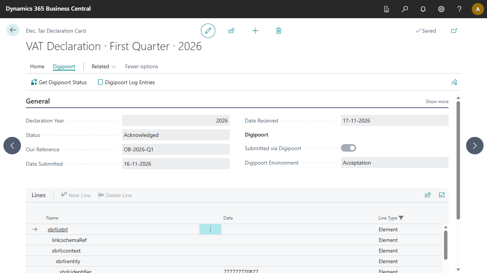

# Submit VAT declarations via Digipoort

## What this feature does

You submit a VAT declaration to Digipoort with **Submit via Digipoort** on the declaration card. The extension creates the XBRL file with standard Business Central and delivers it through Semansys; in Business Central online you do not need a certificate of your own. The declaration goes to the environment in **Digipoort Connector Setup**: in a sandbox always **Acceptation**. With **Acceptation** the declaration is not filed officially, even though its **Status** becomes **Submitted**.

Only a declaration with **Status** **Created** can be submitted. After a delivery that Digipoort accepted, or a delivery whose result is unknown, the declaration cannot be submitted again.

With **Get Digipoort Status** you get the latest Digipoort status of one declaration, or of all VAT declarations that have a **Message ID**. The response messages, the error log and the **Status** of the declaration are then updated. With a job queue entry, the status of submitted declarations is retrieved automatically.

This feature works only for VAT declarations; ICP declarations keep the standard route. This version does not submit several declarations at once, and does not attach the XBRL file or the Digipoort confirmation to the declaration.

## Setup

You need the **Digipoort Connector** permission set, together with your usual permissions to work with electronic tax declarations. The extension must be activated (see [Digipoort Connector Setup](digipoort-connector-setup.md)).

1. Search for **Digipoort Connector Setup**, choose the **Environment** and turn on **Active**. As long as **Active** is turned off, the declaration card and the **Electronic Tax Declarations** page do not show **Submit via Digipoort**, **Get Digipoort Status**, **Generate Submission Message** or **Digipoort Log Entries**, and VAT declarations keep the standard route. **Get Digipoort Status**, searched for directly, then fails for each declaration with *Digipoort Connector is not active. Turn on Active on the page Digipoort Connector Setup.*
2. You do not need to enter URLs: the connection to Semansys is maintained by Bluace. Standard Business Central does require **Digipoort Delivery URL** and **Digipoort Status URL** on the **Elec. Tax Declaration Setup** page, although Digipoort Connector does not send to them. When you turn on **Active**, an empty field is filled with `https://invalid.digipoort.logius.nl`; a field that already has a value is kept.
3. Search for **Elec. Tax Declaration Setup** and open it. On the **Digipoort** FastTab, check the certificate fields, because standard Business Central checks them when it creates the XBRL file, although Digipoort Connector does not use the certificates:
   - When **Use Certificate Setup** is turned on, **Client Certificate Code** and **Service Certificate Code** must be filled in. In Business Central online, turn **Use Certificate Setup** off to work without certificates.
   - On-premises, with **Use Certificate Setup** turned off, **Digipoort Client Cert. Name** and **Digipoort Service Cert. Name** must be filled in.
4. In a sandbox, check that **Allow HttpClient Requests** is turned on; see [After an environment or company copy](after-an-environment-or-company-copy.md).

Good to know:
- Once **Active** is turned on, the card of a VAT declaration no longer shows the standard actions **Submit Electronic Tax Declaration** and **Generate submission message.** (the standard caption ends with a period). It shows **Submit via Digipoort**, **Get Digipoort Status** and **Generate Submission Message** instead. ICP declarations keep the standard actions.
- Once **Active** is turned on, the standard **Receive Response Messages** skips VAT declarations: it does not get their status and does not remove their response messages. Use **Get Digipoort Status** for VAT declarations.
- The VAT number that Digipoort receives comes from **Company Information**, as for the standard declaration. When **Part of Fiscal Entity** is turned on in **Elec. Tax Declaration Setup**, the **Fiscal Entity No.** is used.

## How to use

**Submit a VAT declaration**

1. Search for **Electronic Tax Declarations** and open it.
2. Open the VAT declaration. It must have **Status** **Created**: create its content first with **Create Electronic Tax Declaration**, as in standard Business Central.
3. Choose **Submit via Digipoort**.
4. You are asked *Do you want to submit declaration … to Digipoort (Acceptation)?* For **Production**, the question adds *The declaration is filed officially with the Belastingdienst, and the delivery is charged.* Choose **Yes** to submit. Choose **No** to stop; nothing is sent and nothing is logged.
5. When Digipoort accepted the delivery, a message is shown: *Declaration … was submitted to Digipoort (Acceptation).* The card then shows **Status** **Submitted**, the **Message ID** that Digipoort returned, **Date Submitted**, and in the **Digipoort** group **Submitted via Digipoort** and **Digipoort Environment**.

   

Before the question in step 4, the declaration is checked in this order. The first check that fails shows an error, and nothing is sent:
- The license is not valid or not activated: *Digipoort Connector for Dutch VAT license is not valid or not activated.*
- The declaration does not have **Status** **Created**: *Declaration … has status '…'. Only a declaration with status 'Created' can be submitted via Digipoort.*
- An earlier delivery of the declaration was accepted or has an unknown result: *Declaration … cannot be submitted again, because delivery … in the Digipoort Log Entries has outcome …. Ask an administrator to check this delivery.* See *When the result of a delivery is unknown* below.
- **Digipoort Delivery URL** or **Digipoort Status URL** is empty: *Fill in Digipoort Delivery URL on the Elec. Tax Declaration Setup page before you submit a declaration via Digipoort.* The error names the field that is empty.
- The VAT number in the declaration differs from the company's current VAT number: *Declaration … was created for VAT number …, but the company now has VAT number …. Digipoort refuses a declaration when these differ. Create the declaration again or correct the company information.*

After you choose **Yes**, the submit can still fail. The declaration then keeps **Status** **Created**:
- Standard Business Central stops while it creates the XBRL file, for example when **VAT Registration No.** in **Company Information** or a required certificate field in **Elec. Tax Declaration Setup** is empty. The error names the field. Nothing is sent and nothing is logged.
- Signing in to Semansys fails: the errors described under *Test the connection to Semansys* in [Connection to Semansys and call log](connection-to-semansys-and-call-log.md).
- Semansys refuses the declaration: *Semansys refused declaration … (HTTP status …):* followed by the reason that Semansys gives. Correct the cause and submit again.
- Business Central blocked the request: *Business Central blocked the request to Semansys. …* Turn on **Allow HttpClient Requests** and submit again.
- Semansys answers with a server error, or without a message ID: *The result of the delivery of declaration … is unknown. Do not submit it again; ask an administrator to check the delivery with Bluace.*
- Semansys cannot be reached while the declaration is being delivered: *The connection to Semansys (Acceptation) failed: …*

In the last two cases it is not certain whether Digipoort received the declaration. The delivery gets **Delivery Outcome** **Unknown**, and the declaration cannot be submitted again until the delivery has been checked; see below.

After a failed submit, the calls stay in **Digipoort Log Entries**. When the XBRL file was already created, it stays on the declaration and you can download it with **Download Submission Message**.

**When the result of a delivery is unknown**

Do this only after Bluace has confirmed that Digipoort did not receive the declaration.

1. On the declaration card, choose **Digipoort Log Entries**. The log opens with only the calls for this declaration.
2. Select the line with **Operation** **Delivery** and **Delivery Outcome** **Unknown**.
3. Choose **Actions**, **Mark as Not Delivered**.
4. You are asked *Do you want to mark log entry … as not delivered? …* Choose **Yes**.
5. **Delivery Outcome** changes to **Not Delivered**; no message is shown. You can now submit the declaration again from its card.

The action is refused for a line that is not a delivery (*Log entry … is not a delivery. …*) and for a delivery whose outcome is not **Unknown** (*Log entry … has delivery outcome …. …*). The columns **Resolved By** and **Resolved At**, which you can add to the page with **Personalize**, show who marked the delivery and when.

**Get the Digipoort status of a declaration**

1. Open the card of a submitted VAT declaration.
2. Choose **Get Digipoort Status**.
3. The response messages of the declaration are replaced by the statuses that Digipoort returned, and they are processed as in standard Business Central, which can change **Status** and **Date Received** and fill the error log.
4. A message shows the **Status** of the declaration in Business Central, for example *The Digipoort status of declaration … is Acknowledged.* Choose **Response Messages** to see the Digipoort status texts, and **Error Log** for the errors.
5. In the **Digipoort** group, **Digipoort Status Final** shows whether Digipoort has finished processing the declaration. Each status request is listed in the Digipoort log entries of the declaration, with **Operation** **Status**.

Standard Business Central already sets **Status** to **Acknowledged** when Digipoort has received the declaration (code 100), before the Belastingdienst has accepted or rejected it. Until **Digipoort Status Final** is turned on, the outcome can still change, for example to **Error**. This action also works for a declaration whose status is final.

The action is refused when the license is not valid, or when the declaration has no **Message ID**: *Declaration … has not been submitted via Digipoort.* It can also fail when:
- signing in or connecting to Semansys fails: the errors described under *Test the connection to Semansys* in [Connection to Semansys and call log](connection-to-semansys-and-call-log.md);
- Semansys cannot return the status: *Semansys could not return the status of declaration … (HTTP status …):* followed by the reason.

The declaration, its response messages and its error log are then not changed.

**Get the Digipoort status of several declarations**

1. Search for **Get Digipoort Status** and open it. You can also choose **Get Digipoort Status** on the **Electronic Tax Declarations** page.
2. On the request page, set a filter on **No.** or **Status** if you want to. Without a filter, all VAT declarations with a **Message ID** are included, except those whose **Digipoort Status Final** is turned on. The lines you selected on the **Electronic Tax Declarations** page are not used as a filter.
3. Choose **OK**. Each declaration is handled on its own: when one fails, the others are still updated.
4. At the end a message is shown: *The Digipoort status was retrieved for … declarations. … failed.* When a declaration failed, the message ends with *First error:* and the error of the first declaration that failed.

**Get the Digipoort status automatically**

An administrator sets this up once per company, with the standard job queue. The assisted setup can create this job queue entry for you; see [Set up with the assisted setup](set-up-with-the-assisted-setup.md). To create it yourself:

1. Search for **Job Queue Entries** and open it. Choose **New**.
2. In **Object Type to Run**, choose **Report**. In **Object ID to Run**, choose report **Get Digipoort Status**. **Report Output Type** is set to **None (Processing only)**.
3. Set **Next Run Date Formula** to **1D**, so the job runs once a day. This also turns on **Recurring Job**. Do not set a filter on **Status** with **Report Request Page**: a declaration can already have **Status** **Acknowledged** while Digipoort is still processing it.
4. Set **Maximum No. of Attempts to Run** to **3**, as the assisted setup does, so a failed run is tried again before the job stops.
5. Choose **Set Status to Ready**. The job runs as the user who chooses this action; that user needs the permissions to get the Digipoort status.

At each run, the job gets the status of every submitted VAT declaration whose Digipoort status is not final yet. It never asks sooner than Logius advises (about 15 seconds after the submit, then 1 minute, 15 minutes and 1 hour after the previous check, and after that every 4 hours); with a run once a day, every such declaration is checked. Once Digipoort has reached an end status for a declaration, for example accepted (500) or rejected (510 or 311), **Digipoort Status Final** is turned on and the job no longer checks it. To see a new status sooner, choose **Get Digipoort Status** on the declaration.

No message is shown. When a declaration fails, the others are still updated, but the run ends with an error. The **Log Entries** of the job queue entry then show *The Digipoort status was retrieved for … declarations. … failed. First error:* followed by the error of the first declaration that failed. The job tries again within seconds, up to the number in **Maximum No. of Attempts to Run**:
- When Semansys answered for the failed declaration, for example with an error, that declaration is not checked again in these tries but at the next daily run, so the job normally stays **Ready**.
- When the failure happens before Semansys is asked for the status, for example because signing in to Semansys fails, the license is not valid, **Active** is turned off, or a declaration submitted to **Production** is checked in a sandbox, every try fails again. The **Status** of the job queue entry then becomes **Error** and the job stops, also for the other declarations. Correct the cause, for example by checking the declaration with **Get Digipoort Status** on its card, and choose **Set Status to Ready** on the job queue entry.

Each run adds a **Token** and a **Status** line to **Digipoort Log Entries** for every declaration it checks.

After an environment copy, Business Central stops all job queue entries. Start this one again with **Set Status to Ready** only in an environment that files officially. In a copied sandbox, which always uses **Acceptation**, leave it stopped.

**Create the XBRL file without submitting it**

You can use this, for example, to file the declaration yourself in Mijn Belastingdienst Zakelijk.

1. Open the card of a VAT declaration with **Status** **Created**. For a declaration that was already submitted, use **Download Submission Message** to get the file that was created earlier.
2. Choose **Generate Submission Message**. The XBRL file is created for the declaration; no request page opens and nothing is sent. A progress window of standard Business Central with the text *Submitting Electronic Tax Declaration* can appear briefly; the declaration is not submitted.
3. You are asked *Do you want to download the submission message?* Choose **Yes** to download `Submission.zip`, which contains the XBRL file. You can also download it later with **Download Submission Message**.

This action does not need a valid license and does not call Semansys.

Good to know:
- The status is only updated when you choose **Get Digipoort Status**, or when the job queue entry described above runs.
- The status of a declaration is always requested from the Digipoort environment it was submitted to, as shown in **Digipoort Environment**, also when **Digipoort Connector Setup** now uses another environment. In a sandbox, the status of a declaration that was submitted to **Production** cannot be requested.
- **Digipoort Environment** is also shown on the **Electronic Tax Declarations** page. It stays empty for declarations that were not submitted via Digipoort Connector.
- On **Digipoort Log Entries**, the request of a **Delivery** line does not contain the XBRL file, only a reference to the declaration. Use **Download Submission Message** on the declaration for the file itself.
- In this version, everyone with the **Digipoort Connector** permission set can use **Mark as Not Delivered**.
- A declaration with **Status** **Error** or **Warning** cannot be submitted again, because only **Created** declarations can be submitted.
- **Digipoort Log Entries** is also available on the **Electronic Tax Declarations** page. It opens the calls for the line you are on.
- **Submit via Digipoort** and **Generate Submission Message** are also available on the **Electronic Tax Declarations** page, for the line you are on. Like on the card, the Digipoort actions are shown only when the line you are on is a VAT declaration and **Active** is turned on; on an ICP declaration they are hidden.
